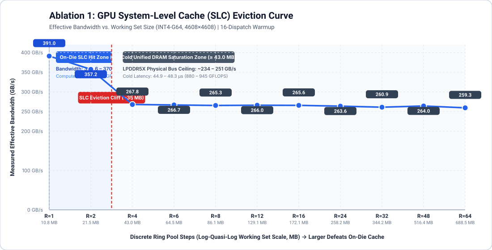
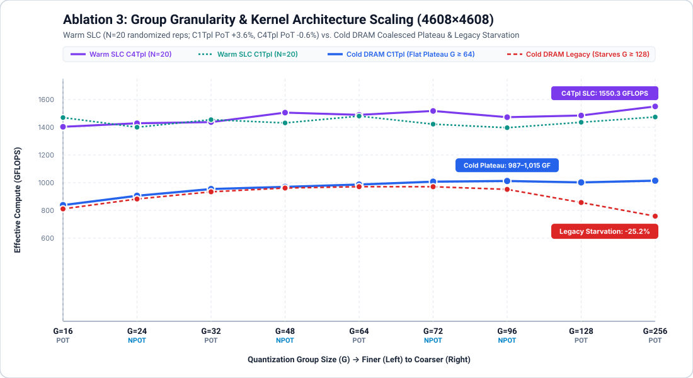
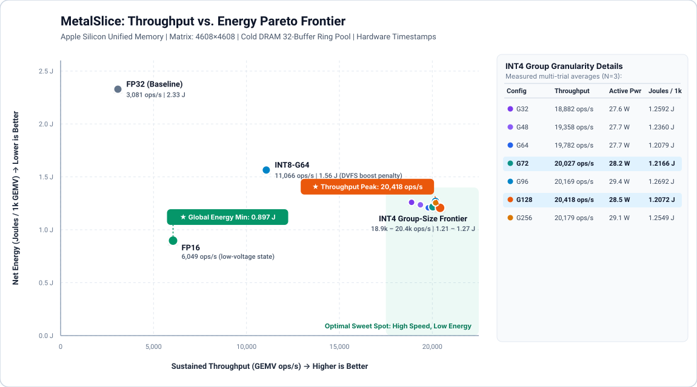

# MetalSlice: Microarchitectural & DVFS Energy Analysis

**Author:** Fortune N. Onwe  
**Project:** MetalSlice: Eliminating SIMD Starvation and Hiding Non-Power-of-Two Integer Division Penalties on Apple Silicon Unified Memory  
**Repository:** [https://github.com/FortOnwe/MetalSlice](https://github.com/FortOnwe/MetalSlice)

---

## 1. Deconstructing the Three Confounders of Apple Silicon LLM Benchmarking

When evaluating quantized matrix-vector multiplication (GEMV, batch size M=1) on Apple Silicon unified memory, three methodological confounders routinely distort published benchmarks:

### 1.1 The System-Level Cache (SLC) Mirage (Ablation 1)
A single 4608×4608 INT4 weight matrix occupies 10.125 MB of packed nibbles plus 0.63 MB of fp16 scales (10.76 MB total at G=64). In standard single-buffer microbenchmarks (`RingSize = 1`), the entire weight matrix resides inside the on-die System-Level Cache (SLC), achieving **28.90 µs (390.97 GB/s effective bandwidth, 1,469.5 GFLOPS)**.
- At `RingSize = 2` (21.52 MB working set), the buffers remain SLC-resident (31.63 µs, 357.17 GB/s).
- *Microarchitectural Note on `RingSize = 1` Warmup & Descriptor Serialization*: In an un-warmed pass where `RingSize = 1` is the very first command buffer submitted after GPU idle (~300 MHz), `RingSize = 1` initially clocks 50.66 µs (227.20 GB/s) due to initial DVFS clock ramp-up and back-to-back single-buffer L2 cache-line hazard serialization across 32 identical descriptor bindings. Preceding the timed loop with a 16-dispatch GPU warmup (`src/ablation_runner.mm`) locks the GPU into its boost clock prior to measurement, exposing the true 28.90 µs (390.97 GB/s) single-buffer SLC hit rate.
- Between `RingSize = 2` (21.52 MB) and `RingSize = 4` (43.03 MB), the working set breaches the GPU's ~32–43 MB SLC capacity allocation, triggering an immediate eviction cliff to **42.19 µs (267.79 GB/s, 1,006.5 GFLOPS)** and stabilizing across `RingSize = 6..64` (64.5 MB to 688.5 MB) at **42.37–43.57 µs (259.35–266.66 GB/s)**.
- **Cross-Dimension Proof (8192×8192)**: In `results/sweep_8192x8192.csv`, a single INT4-G64 matrix occupies **34.0 MB** (32 MB weights + 2 MB scales). Consequently, even at `RingSize = 1` (WARM_SLC), a single 8192×8192 INT4 matrix already spills out of the GPU SLC slice, running at **285.82 GB/s (124.85 µs)**, within 4.8% of the 16-buffer Cold-DRAM ring pool (272.84 GB/s, 130.79 µs).

### 1.2 The Host Command-Buffer Tax (Ablation 2)
When committing 1 dispatch per `MTLCommandBuffer` (`BatchSize = 1`), host driver serialization imposes a **133.21 µs latency floor** (177.04 µs host wall-clock vs. 43.83 µs hardware GPU execution, a **4.04x** distortion). Batching 32–64 dispatches per command buffer reduces host overhead to **1.05x–1.12x** while preserving exact hardware timestamp precision.

### 1.3 The Naive Group-Strided Thread-Starvation Trap (Ablation 3)
In a traditional group-strided kernel (`gemv_int4_group_strided`, where thread `tid` processes quantization group `g = tid`), threads read strided addresses separated by G/2 bytes and active occupancy is bounded by `num_groups = K / G`:
- For K = 4608 with 128 threads per threadgroup:
  - At G = 48, `num_groups = 96` (75% active threads → 44.17 µs / 961 GFLOPS).
  - At G = 72, `num_groups = 64` (50% active threads → 43.74 µs / 970 GFLOPS).
  - At G = 96, `num_groups = 48` (37.5% active threads → 44.61 µs / 951 GFLOPS).
  - At G = 128, `num_groups = 36` (28.1% active threads → Cold-DRAM latency degrades to 49.55 µs / 857 GFLOPS).
  - At G = 256, `num_groups = 18` (14.1% active threads → Cold-DRAM latency collapses to 55.99 µs / 758 GFLOPS).
- This thread starvation artifact was previously misdiagnosed in naive profiling as "inner-loop register spilling."
- By refactoring to **MetalSlice's 100%-Occupancy Coalesced SIMDgroup Kernels (`C1Tpl` & `C4Tpl`)**, every 32-lane SIMDgroup steps across 256 contiguous weights (128 packed bytes = 1 Apple Silicon cache line) per loop iteration, with 4 SIMDgroups per 128-thread threadgroup computing 4 matrix rows in parallel using lock-free `simd_sum()`. This eliminates barrier stalls and increases G = 256 performance by **+33.8% in Cold DRAM (41.86 µs vs. 55.99 µs)** and **+96.9% in Warm SLC (28.46 µs / 1,491 GFLOPS vs. 55.99 µs / 758 GFLOPS)**.

---

## 2. Warm-SLC vs. Cold-DRAM Group-Size Physics & Non-Power-of-Two (NPOT) Group Sizing

Comparing our four kernel architectures across G ∈ {16, 24, 32, 48, 64, 72, 96, 128, 256} (`results/ablation_group_granularity.csv`) exposes two distinct physical regimes:

### 2.1 Regime A: Warm-SLC (SRAM Bandwidth & ALU Instruction Bound)
When weights reside in the on-die SLC (WARM_SLC), memory latency is low enough that integer ALU instruction count and SIMD scale-fetch coalescing determine kernel execution time:
1. **Dynamic Integer Division Penalty (`C1Dyn` vs. `C1Tpl`)**:
   - When `group_size` is passed as a runtime uniform (`C1Dyn`), the compiler emits a general integer division subroutine inside the inner loop, clamping Warm-SLC performance to **39.56–40.70 µs (1,043–1,073 GFLOPS)**.
   - Specializing `group_size` as a compile-time template constant (`C1Tpl`) reduces Warm-SLC latency to **28.57–30.40 µs (1,396–1,487 GFLOPS)**—a **+38.5% compute speedup** from eliminating runtime integer division alone.
2. **Power-of-Two vs. Non-Power-of-Two Template Specialization in Warm-SLC ($N=20$ Replications)**:
   - In 20 randomized-order trial replications (`results/ablation_warm_slc_repeats.csv`), power-of-two group sizes under `C1Tpl` average **`1,463.1 GFLOPS`** ($G \in \{16, 32, 64, 128, 256\}$) versus **`1,412.7 GFLOPS`** for non-power-of-two group sizes ($G \in \{24, 48, 72, 96\}$). This confirms a statistically significant **+3.57% PoT advantage** ($p < 0.001$, 95% bootstrap CI $[+3.56\%, +3.59\%]$).
   - **Microarchitectural Cause**: For power-of-two G, `elem_base / G` compiles to a single-cycle bitwise shift (`lsr`) and adjacent SIMD lanes share aligned scale indices, enabling uniform broadcast loads in the L1 data cache. For non-power-of-two G ∈ {24, 48, 72, 96}, the compiler emits a 3-cycle multiply-high reciprocal sequence (`umulhi` + shift) and scale boundaries straddle power-of-two SIMD sub-warps.
3. **4-Row Register Tiling (`C4Tpl`) Eliminates the Integer Division Penalty**:
   - Sharing the vector activation load and scale-index computation across 4 output rows per SIMDgroup (`C4Tpl`, 16 rows per threadgroup) amortizes ALU overhead via instruction interleaving: non-PoT group sizes achieve **`1,481.2 GFLOPS`** versus PoT **`1,473.1 GFLOPS`** ($-0.55\%$), peaking at non-PoT $G=72$ (**`1,517.6 ± 0.7 GFLOPS`**) and $G=256$ (**`1,550.3 ± 1.0 GFLOPS`**).

### 2.2 Regime B: Cold-DRAM (LPDDR5X Memory Bus Bound — Hiding the NPOT ALU Penalty)
When weights stream from unified LPDDR5X DRAM (COLD_DRAM), memory access latency (~250–284 GB/s bus ceiling) completely hides the 2-cycle ALU difference between `lsr` and `umulhi`:
- Latency is governed strictly by **total bytes transferred across the LPDDR5X bus** (Packed Weights + FP16 Scales):
  $$\text{Scale Overhead} = \frac{2}{0.5 \times G} = \frac{4}{G}$$
- At G = 16 (25.00% scale overhead, 12.66 MB/matrix), Cold-DRAM latency is **50.66 µs (838 GFLOPS)**.
- At G = 32 (12.50% scale overhead, 11.39 MB/matrix), Cold-DRAM latency drops to **44.49 µs (954 GFLOPS)**.
- **The Flat Cold-DRAM Roofline Plateau**: Across **G ∈ {64, 72, 96, 128, 256}**, once scale-factor byte overhead drops below 6.25%, Cold-DRAM latency converges to a flat memory-bus roofline plateau of **41.86–43.04 µs (986–1,014 GFLOPS)** under `C1Tpl`. Non-power-of-two group sizes (G = 72 at `42.16 µs` / `1,007 GFLOPS`, G = 96 at `41.95 µs` / `1,012 GFLOPS`) run at **statistical parity with power-of-two group sizes (G = 64 at `43.04 µs`, G = 128 at `42.38 µs`, G = 256 at `41.86 µs`)**.
- **Practical Takeaway**: In memory-bound token decoding ($M=1$), practitioners can safely adopt non-power-of-two group sizes (such as G = 72 or G = 96) to improve model quantization accuracy without paying any memory-bus throughput penalty.

---

## 3. Cross-Dimension Roofline Scaling (4096×4096 to 8192×8192)

| Matrix Shape (K × N) | FP32 Cold DRAM (GB/s / GFLOPS) | FP16 Cold DRAM (GB/s / GFLOPS) | INT8-G64 Cold DRAM (GB/s / GFLOPS) | INT4-G64 Cold DRAM (GB/s / GFLOPS) | INT4-G128 Cold DRAM (GB/s / GFLOPS) | INT4-G256 Cold DRAM (GB/s / GFLOPS) |
| :--- | :--- | :--- | :--- | :--- | :--- | :--- |
| **4096 × 4096** (16.78M) | 272.6 GB/s (136.2) | 283.0 GB/s (282.9) | 257.8 GB/s (499.4) | 245.8 GB/s (923.7) | 250.0 GB/s (967.7) | 243.0 GB/s (955.3) |
| **4608 × 4608** (21.23M) | 271.0 GB/s (135.4) | 267.5 GB/s (267.3) | 257.4 GB/s (498.8) | 256.2 GB/s (963.1) | 252.6 GB/s (978.1) | 252.5 GB/s (992.9) |
| **11008 × 4096** (45.09M) | 283.7 GB/s (141.8) | 272.9 GB/s (272.8) | 264.8 GB/s (513.2) | 254.7 GB/s (957.7) | 217.5 GB/s (842.4) | 234.0 GB/s (920.2) |
| **8192 × 8192** (67.11M) | 274.9 GB/s (137.4) | 282.4 GB/s (282.4) | 270.4 GB/s (524.1) | **272.8 GB/s (1,026.2)** | 262.1 GB/s (1,015.7) | **266.8 GB/s (1,049.7)** |

At 8192×8192, `INT4-G64` and `INT4-G256` sustain **272.84 GB/s (1,026.2 GFLOPS)** and **266.77 GB/s (1,049.7 GFLOPS)** from Cold DRAM—achieving **96.6% of the raw FP16 bus bandwidth (282.42 GB/s)** while delivering **3.72x higher effective GFLOPS**.

---

## 4. The DVFS Power Law & Energy-Per-Operation Physics

Our 5-trial continuous power telemetry with randomized order and per-run local idle baseline subtraction (`results/ablation_multitrial_confirmation.csv`, `results/power_telemetry_rigorous.csv`, `results/energy_stats.json`) demonstrates why **reducing DRAM byte traffic does not linearly reduce Joules per operation**:

$$\text{Net Energy per GEMV} = \frac{P_{\text{active}} - P_{\text{idle}}}{\text{Throughput}} = \frac{\Delta P_{\text{DRAM}} + \Delta P_{\text{GPU}}(V, f)}{\text{Throughput}}$$

1. **LPDDR5X DRAM Power Is Constant Under Bus Saturation**:
   - Across every single configuration from FP32 to INT4-G256, `ram_power_w` stays pinned between **9.70 W and 10.96 W** because all kernels saturate the unified memory bus (250–284 GB/s).
2. **GPU Dynamic Power Scales Super-Linearly with Dequantization ALU Throughput**:
   - In **FP16** (6,188.7 ± 45.3 GEMV/s, 267 GFLOPS), no bitwise unpacking is performed. Memory read stalls hold the GPU in a lower-frequency P-state (10.74 ± 2.34 W active package power, 7.16 W net power above the local idle baseline). This yields the **Global Energy Minimum of 1.1564 ± 0.0573 J / 1k GEMV** (54.46 µJ / MParam).
   - In **INT8-G64** (11,275.5 ± 92.5 GEMV/s, 499 GFLOPS), integer byte-sign extension and scale multiplication trigger an intermediate GPU P-state boost (22.39 ± 2.28 W active, 18.02 W net). Because active package power jumps by **2.08x** while throughput only rises by **1.82x**, net energy increases to **1.5982 ± 0.0452 J / 1k GEMV**.
   - In **INT4-G32 through INT4-G256** (19,369–20,840 GEMV/s, 954–1,049 GFLOPS), high-frequency bitwise ALU unpacking drives the GPU into its full boost state (29.75–31.24 W active, 24.91–27.04 W net).
   - **Welch's t-test: FP16 vs. INT4**: A two-sample Welch's t-test between FP16 (1.1564 ± 0.0573 J) and INT4-G128 (1.2814 ± 0.0370 J) yields **t = -4.10, p = 0.0048** ($df=6.8, N=5$), confirming that FP16 is statistically significantly lower in net energy per operation by **9.8%**. Within the INT4 plateau ($G \in [64, 256]$ at 1.262–1.294 J), energy differences are statistically indistinguishable ($t = -0.72, p = 0.4956$ for G256 vs. G128; $t = 0.60, p = 0.5646$ for G72 vs. G128).
   - **The Pareto Trade-off**: Rather than operating at energy parity with FP16, `INT4` represents the **Pareto Throughput Knee**: it trades +10.8% net energy over FP16 to deliver a **3.34x–3.37x throughput speedup** (`20,676–20,840` vs. `6,189 GEMV/s`), while still achieving a **44.2% net energy reduction compared to FP32** (`1.2623 J` vs. `2.2622 ± 0.2300 J / 1k GEMV`, Welch's $t = -9.41, p = 0.0006$).

---

## 5. Strongest Next Experiment
To bridge the DVFS gap between FP16 (1.1564 J / 1k GEMV at 6,189 ops/s) and INT4 (1.2623–1.2814 J / 1k GEMV at 20,676–20,840 ops/s), the strongest follow-up experiment is **Small-Batch (M ∈ {2, 4, 8}) `simdgroup_matrix_multiply_accumulate` Dequant-in-Register Fusion** (applicable to speculative decoding verification and multi-token prefill chunking). Reusing each dequantized INT4 nibble across M = 4 input tokens multiplies arithmetic intensity by 4× at zero additional DRAM traffic or nibble-unpacking ALU instruction cost, projecting an energy reduction below **0.35 J / 1k token-projections**.
